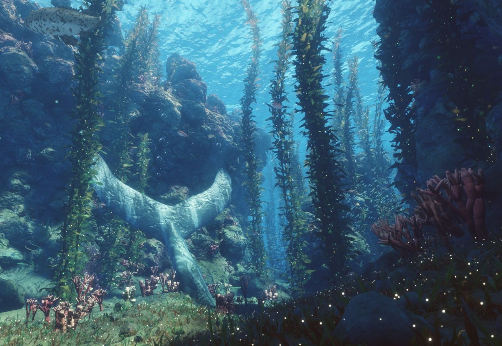
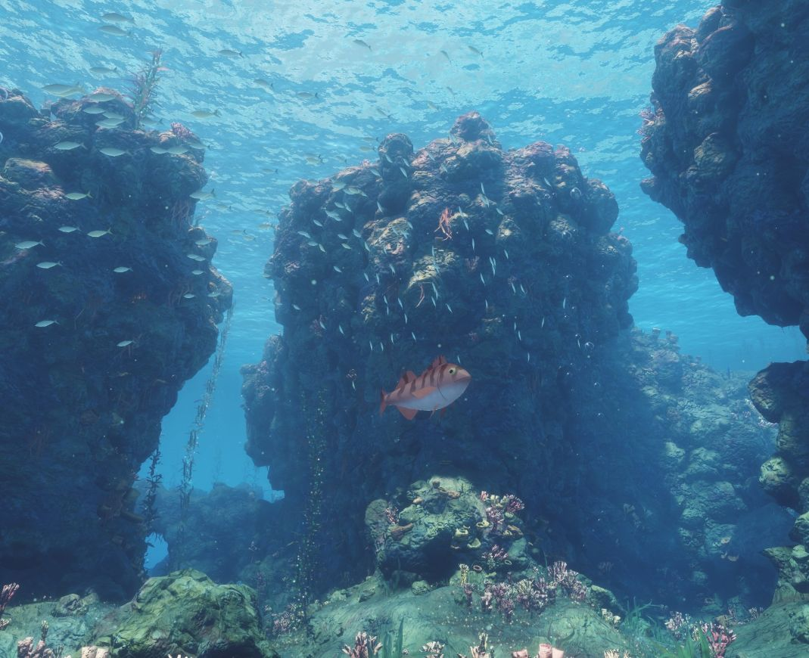
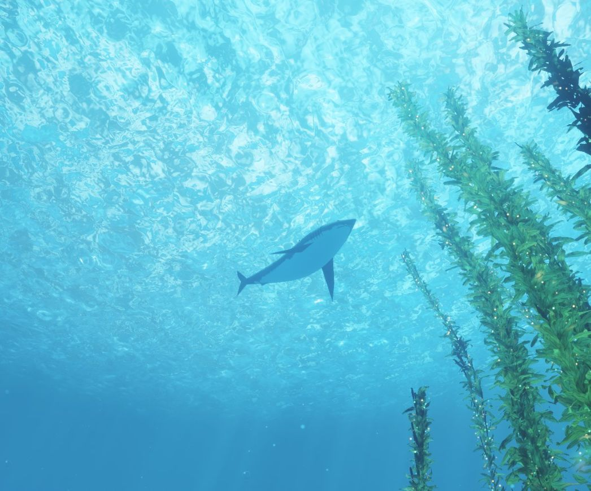
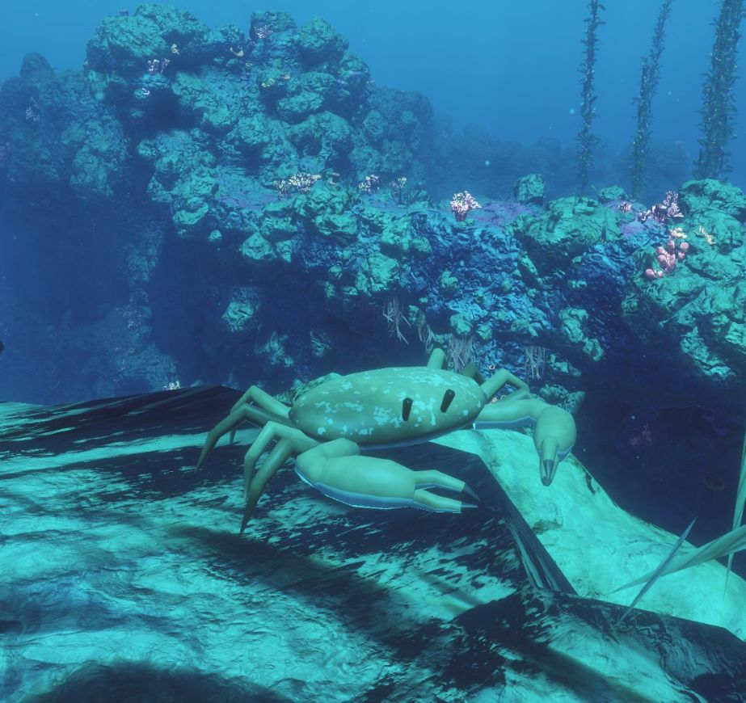
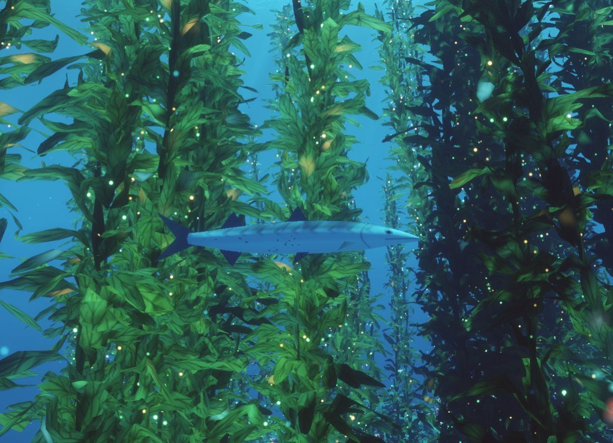
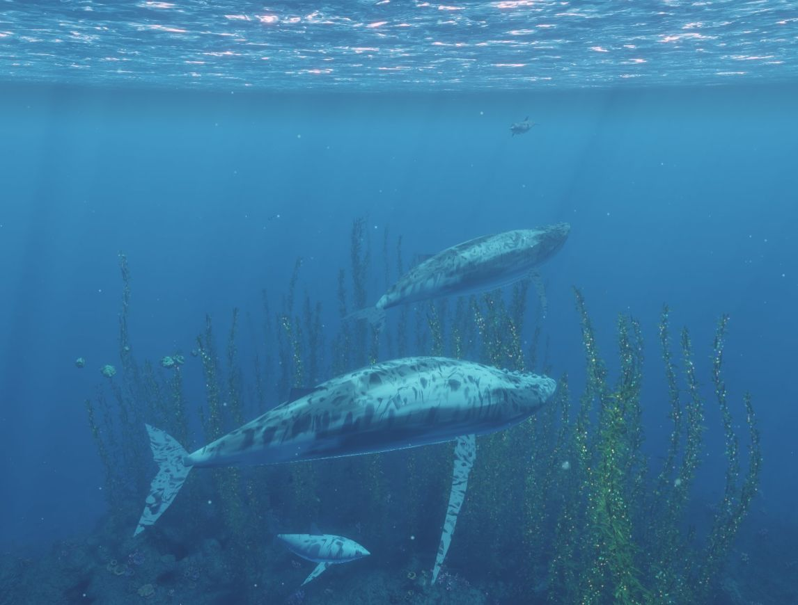
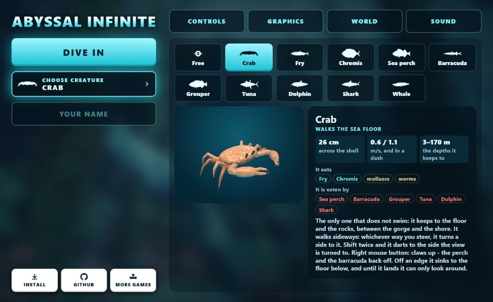

# Abyssal Infinite

**An endless sea where you play as one of its creatures, alongside anyone else who is online. It runs in your browser.**

- **Be a creature.** Pick one of ten species, from a crab on the sea floor to a whale. Hunt or graze to stay alive,
  outrun whatever hunts you, and hide behind rock and kelp.
- **One sea for everyone.** Other players swim among the sea's own creatures. You can see them, hear them, spot them
  on the sonar, eat them or get eaten.
- **Crab battles.** Crabs fight each other, bots and players alike: strike, block, lose a claw, and eat the one
  you beat.
- **It never ends.** Swim in any direction and the world is generated around you. Come back later and every place is
  exactly as you left it.
- **Made entirely by code.** No images, no 3D models, no sound files: **one small HTML file**, nothing to install.

> A fork of [Abyssal Garden](https://github.com/Noniv/abyssal-garden) by Maksymilian Dendura (MIT), a single
> hand-crafted underwater scene. This fork keeps that scene as your starting point and adds the endless sea, the
> playable creatures and multiplayer.

<p align="center">
  
  
  
</p>
<p align="center">
  
  
  
</p>

## Play

**https://abyssal-infinite.wasd.fly** - multiplayer: everyone who opens it plays in the same sea. The game's page, next
to other browser games: [wasd.fly/abyssal-infinite](https://wasd.fly/abyssal-infinite/).

To play on your own, offline: download [`index.html`](index.html) and open it in **Chrome** or **Edge** on a desktop
computer. You need a browser with **WebGPU**. It also runs on an iPhone with iOS 26 (Safari or Chrome).

## How to play

<p align="center">
  
</p>

**Pick a creature** with the creature button in the menu: crab, fry, chromis, perch, barracuda, grouper, tuna,
dolphin, shark or whale. The panel shows each one's size, speed, depth range, what it eats and what eats it. You can
also choose the free camera and just look around.

**Stay alive.** Health drains on its own over seven minutes, food restores it, and every bite you take costs you
some. At zero you come back as a new creature of the same species. Hunters eat anything up to 60% of their own
length; the small fish pick at plankton, the whale filters it, and the crab picks food off the floor. Hunters lose
you when they cannot see you, so rock, kelp and the ship are places to hide.

**Crabs fight each other**, bots and players alike. Face the other crab and strike with the left button, or hold
the right one to raise your claws and block. A strike can tear off a claw, and a crab with no claws cannot strike.
A beaten crab lies on its back for eight seconds: eat it, or it gets up again without its claws. Claws grow back,
one every 45 seconds.

**Gurgle** to "talk": every species has its own voice, heard about 34 m away, and a nearby bot of your species
answers. **The sonar** in the corner shows every creature within 100 m, colored by what it is to you: food, danger
or neither. Other players are labeled with their names. A green crescent at
the rim shows the way home once you are more than 50 m from it.

| | |
|---|---|
| Look around | Move the mouse |
| Swim | `W` `A` `S` `D` (and `E` / `Q` for up and down with the free camera) |
| Dash | Hold `Shift` |
| Burst of speed | `Shift` twice |
| Bite, strike, feed | Left mouse button |
| Gurgle | Hold the right mouse button |
| Camera nearer, further | Mouse wheel |
| Jump to a viewpoint | `1` to `6` at home, `7` to `0` in the deep |
| Menu / sound / stats | `Esc` / `M` / `H` |

Rock is solid: you slide along it instead of stopping. On a touchscreen, hold one finger to swim, slide it to steer,
and add a second finger to go faster (experimental).

## The world

The sea floor follows one profile from east to west, and each zone has its own terrain and life:

- **Shore**: pale sand, sea grass and coral reefs in the sunlit shallows.
- **Shelf**, 45 m down: the original's home region (kelp forests, a sunken ship, a stone whale tail, a purple grotto)
  and endless terrain like it, with arches, pillars, canyons and spires.
- **The gorge**, 720 m west of home: sheer walls up to 36 m high, with caves.
- **The rift**, 980 m west: a chasm 200 m deep, with ledges, caves and vents.
- **Slope**: terraces and canyons, where the kelp ends as the light does.
- **Abyssal plain**, 565 m down: sediment, pillow lava and steaming chimneys. Few fish, hardly any plants.

Each species keeps to its own depths, so you meet different animals as you go deeper.

## Multiplayer

The server only relays players; each browser generates its own world and runs its own bots. You are told about the 40
nearest players, and your bots make room for them. A full sea turns newcomers away: they play alone and are let in
automatically when a place frees up.

You can host the sea yourself, on Cloudflare Workers (100 players) or on your own server with OpenResty (300 players):
see [`server/README.md`](server/README.md). A page opened from a file plays alone.

## Settings

All in the menu, and remembered by your browser:

- **Detail** (Low / Medium / High): how much grows in the world and how many creatures surround you. On a first visit the game asks which
  level to start with (Low is proposed). If loading crashes the tab, the page starts again one level lower.
- **Graphics**: draw distance, resolution, frame rate (30, 60 or as many as the screen shows), plants, shadows,
  anti-aliasing, light rays, the surface (flat, or simulated waves). Applying them reloads the page.
- **World**: the water (Lagoon, Clear or Crystal), how many creatures live around you (Few, Medium, Many; with Few,
  health drains half as fast), the time of day (Morning, Noon, Evening, Night) the colours (Vivid, or Natural
  without the magenta and turquoise) and the boulders floating in the water (off unless you turn them on).
- **Sound**: separate levels for water, music, sea life and gurgling.

## How it works

- The world is an endless grid of 48 m tiles; up to 8 × 8 around you are loaded (6 × 6 at the shortest draw distance), and the water's haze hides the rest.
- A tile's rock is sculpted on the graphics card, a few slices per frame. A background worker then builds the sea
  floor and grows kelp, plants, rocks, corals and fish on it, so swimming stays smooth.
- Everything is a function of position and seeded by where it happens, which is why a place is the same every time.
- Everything is drawn with **WebGPU** directly: no game engine, no 3D library. Models are built from simple shapes,
  and the sound is synthesized live.
- With the resolution on auto, the game aims for 60 fps (30 if you set that frame rate) by lowering the resolution
  and then the draw distance of small things.

The details, with the names of the functions and constants behind each feature, are in [`DETAILS.md`](DETAILS.md).

## Build it yourself

The source is in [`source`](source). You need [Node.js](https://nodejs.org) 18 or newer:

```bash
cd source
npm install
npm run build
```

This writes a new `index.html`. `npm run build:readable` writes an unminified one, and `npm run build:dev` writes
`dev.html` with a fly-through, a benchmark and hooks for automated tests. [`DETAILS.md`](DETAILS.md) lists the source
files and some easy first tweaks.

## License

[MIT](LICENSE): free to use, change and share, including in your own projects. The original work is © 2026 Maksymilian Dendura; keep that notice when you publish a fork. The optional wave simulation comes from his [web-ocean](https://github.com/Noniv/web-ocean) (MIT).
