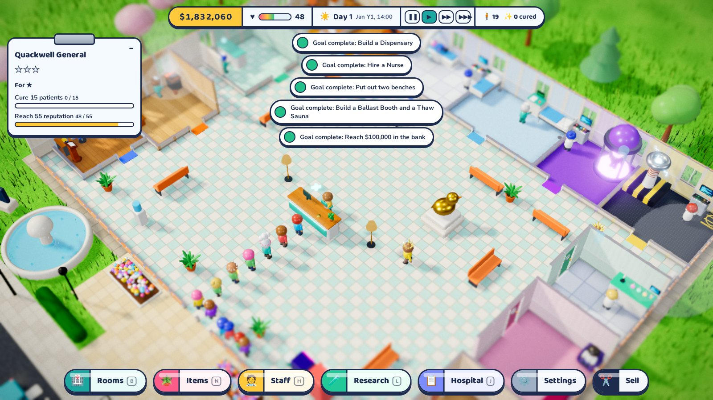
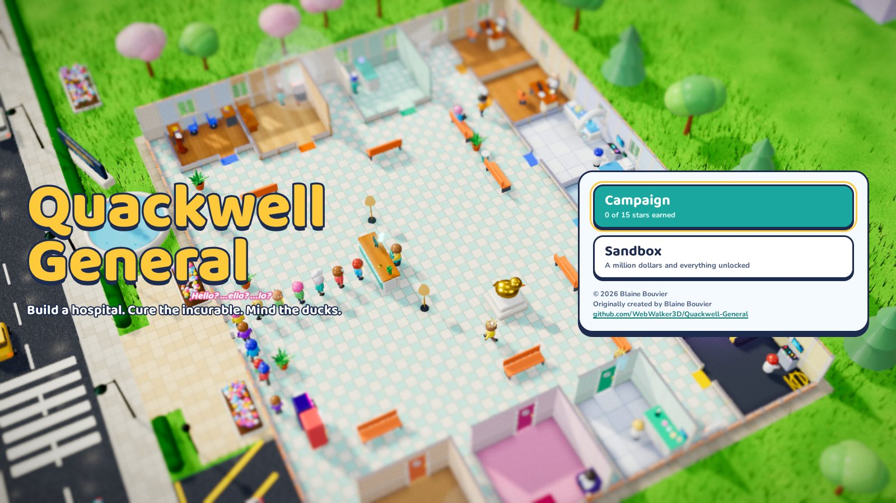
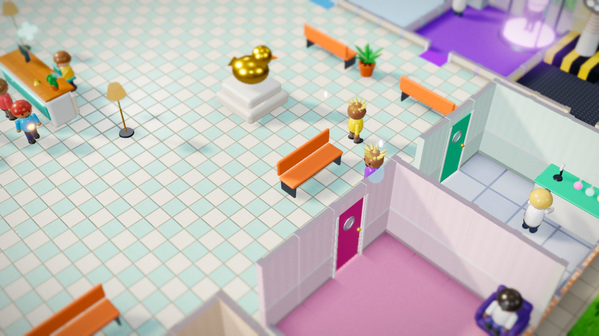
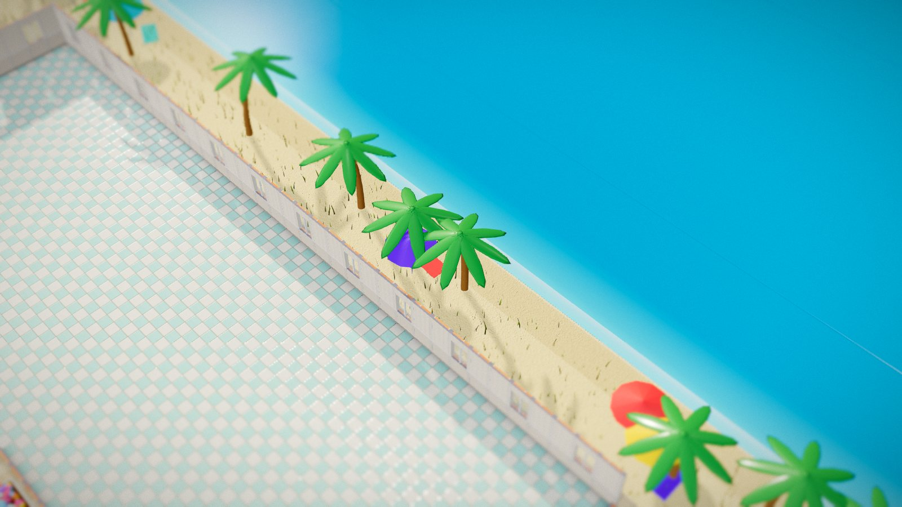
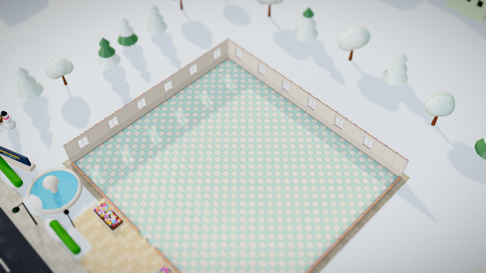
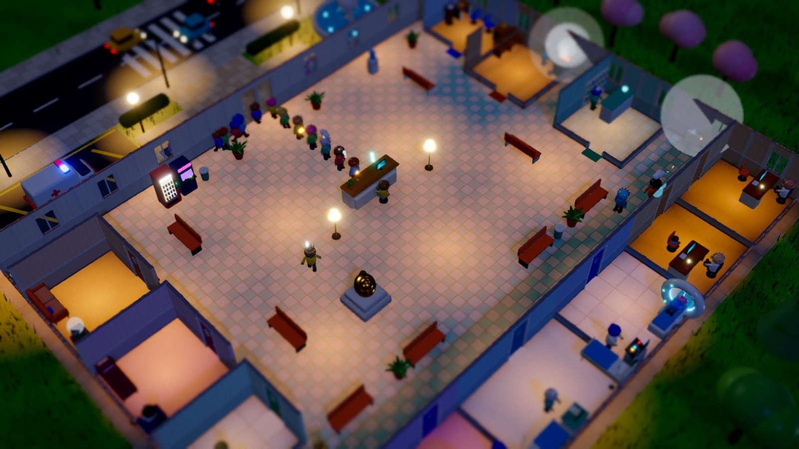

# Quackwell General

A hospital management sim with toy-box graphics. You build rooms, hire staff and cure five towns of illnesses
no textbook has heard of, all inside a glossy miniature diorama rendered in real time in your browser.

**[Play it in your browser](https://webwalker3d.github.io/Quackwell-General/)**. There's nothing to install.



## What's in it

**The game**

- Drag out rooms in the corridor and the equipment installs itself. There are eleven rooms, from the Consult Room to the Grounding Room and its lightning coil.
- Hire doctors, nurses, assistants and janitors, each with a skill rating, a trait and a monthly salary.
- Patients check in at the front desk, see a doctor until they're diagnosed, then head to the right treatment room.
- Ten original illnesses, among them Helium Lungs, Chromatic Flu, Static Cling, Bubble Trouble, Echo-itis and Ghosting. New ones turn up as the months go by.
- Queues, benches, thirst, patience, decor, treatment prices, reputation and payday at the end of each month. Neglect any of them and patients storm out.
- Staff get tired and need a Staff Room; push them too hard and they quit. They gain experience on the job, and the Training Room adds skill stars faster.
- Patients drop cans and wrappers, and machines wear out and break down. Janitors sweep up and fix things.
- A Research Lab works through projects that unlock new rooms (Therapy Room), new items (Arcade Cabinet, Golden Duck Statue) and hospital-wide upgrades.
- Ambulance emergencies with a deadline and a bonus, surprise health inspections, and awards at the end of every year.
- Autosave every in-game day, plus three save slots in the pause menu.
- A campaign of five hospitals, each with its own building, illness mix and three star goals. One star opens the next town:
  - **Quackwell General** is a meadow town where you learn the ropes.
  - **Frostmere Clinic** is a cramped clinic in endless snow.
  - **Sunnyside Seaside** sits on a beach full of tourists, and the ambulance never stops.
  - **Voltwick Works** is a factory town where the board wants research.
  - **Grand Duckington** is the big city, with a huge building and every illness at once.
- Sandbox mode: any unlocked town with a million dollars, everything unlocked and no goals.

**The graphics**

- Vinyl-toy characters, shown in the hundreds through instanced rendering, with walk cycles, blinking, expressions and an effect for each illness.
- A day/night cycle with soft shadows, bloom, tilt-shift depth of field, color grading and seasonal rain and snow.
- Wind-blown grass and trees, road traffic, a working fountain and an ambulance with flashing lights.
- Walls cut away automatically as you rotate the camera, and characters show as silhouettes behind them.
- Confetti, spinning coins and floating cash on every cure. Room walls spring up and furniture drops in with a bounce.
- Every texture, model and sound is generated in code, with no downloaded assets. That includes a background tune that composes itself.
- Each town has its own scenery: meadows and blossom trees, snowbanks and snowmen, a beach with palms and a rolling ocean, smoking factory chimneys, and city towers whose windows light up at night.
- The title screen orbits a live, busy hospital.

| | |
|---|---|
|  |  |
|  |  |
|  | |

## Playing

The quickest way is the hosted copy at https://webwalker3d.github.io/Quackwell-General/, which needs a browser
with WebGL 2. To run it yourself you also need Node.js 20 or newer.

```bash
npm install
npm run dev
```

Then open the address it prints, usually http://localhost:5173. The title screen has Continue, Campaign and Sandbox.
Campaign progress and saves live in your browser's local storage.

Each [release](https://github.com/WebWalker3D/Quackwell-General/releases) also has a ready-built copy that needs no
install. Unzip it and serve the folder with any static web server, for example `npx serve quackwell-general`.
Opening `index.html` straight from disk won't work, because browsers block its scripts there.

| Action | Control |
|---|---|
| Pan | Right-drag, middle-drag, WASD or arrow keys |
| Zoom | Mouse wheel |
| Rotate the view | Q / E |
| Pause, speeds | Space, 1, 2, 3 |
| Rooms, Items, Staff, Research, Hospital | B, N, H, L, J |
| Pause menu (save and load) | Esc |
| Sell tool | X |
| Rotate an item before placing it | R |
| Sell the selected room or item | Delete (twice for rooms) |
| Hide the interface | P |

### Graphics settings

Settings has four presets. The game picks High on integrated graphics and Ultra on dedicated cards. Ultra
adds screen-space ambient occlusion, 4K shadow maps and about 70,000 grass blades. On every preset the
render resolution drops automatically if the frame rate falls below 45 fps; you can switch this off.

## Development

```bash
npm test           # simulation tests (Vitest)
npm run typecheck
npm run build      # typecheck and production bundle in dist/
```

The simulation in `src/sim` is plain TypeScript with no rendering code. It runs on a fixed 1/30 s step and
is covered by the tests. `src/render` reads the simulation state each frame and owns everything you see. `src/ui`
turns clicks and keys into simulation commands. Balance numbers live together in `BALANCE` in
`src/sim/catalog.ts`.

Every push to `main` runs the tests, builds the game and publishes it to GitHub Pages
(`.github/workflows/pages.yml`). Asset paths in the build are relative, so `dist/` also works from any subfolder.

The scripts in `scripts/` drive a real GPU-backed Chromium through Playwright:

- `node scripts/shot.mjs <url> <out.png>` takes a screenshot
- `node scripts/play.mjs` plays a short game through the interface
- `node scripts/perf.mjs <url> 1920x1080` measures frame rate

These URL flags are handy with them:

| Flag | Effect |
|---|---|
| `?play=<town>` | Start a town directly: `quackwell`, `frostmere`, `sunnyside`, `voltwick`, `duckington`. Add `&sandbox` for sandbox mode |
| `?load=auto` (or `1`, `2`, `3`) | Load a save slot |
| `?demo=1` | A busy showcase hospital |
| `?demo=items` | Every item side by side |
| `&t=0.95` | Night |
| `&weather=rain` or `&weather=snow` | Force the weather |
| `&cam=0` to `&cam=3` | Camera angle |
| `&q=ultra`, `high`, `medium` or `low` | Graphics preset |
| `&ui=0` | Hide the interface |
| `&event=emergency` or `&event=inspection` | Start an event right away |
| `&mess=1` | Scatter litter, break the coil and hire a janitor |

## Roadmap

- **Milestone 2 (done):** staff needs and training, janitors, machine wear, research, emergencies, inspections, awards, saving and loading.
- **Milestone 3 (done):** a campaign of five themed hospitals with star goals, a sandbox mode and a title screen.
- **Hosted build (done):** playable on GitHub Pages, redeployed on every push to `main`.
- **Next:** more illnesses and rooms, staff traits that matter more.

## License

Quackwell General is licensed under the [Common Public Attribution License 1.0](LICENSE) (CPAL-1.0).

The CPAL is the Mozilla Public License 1.1 with two additions:

- **Attribution:** anything built from this code, including larger works that contain it, must display the
  attribution in Exhibit B each time it starts. The game already shows it on the welcome screen and in Settings.

  > © 2026 Blaine Bouvier. Originally created by Blaine Bouvier. https://github.com/WebWalker3D/Quackwell-General

- **Network use:** letting other people use a modified version over a network counts as distribution, so you
  must make your source code available.
